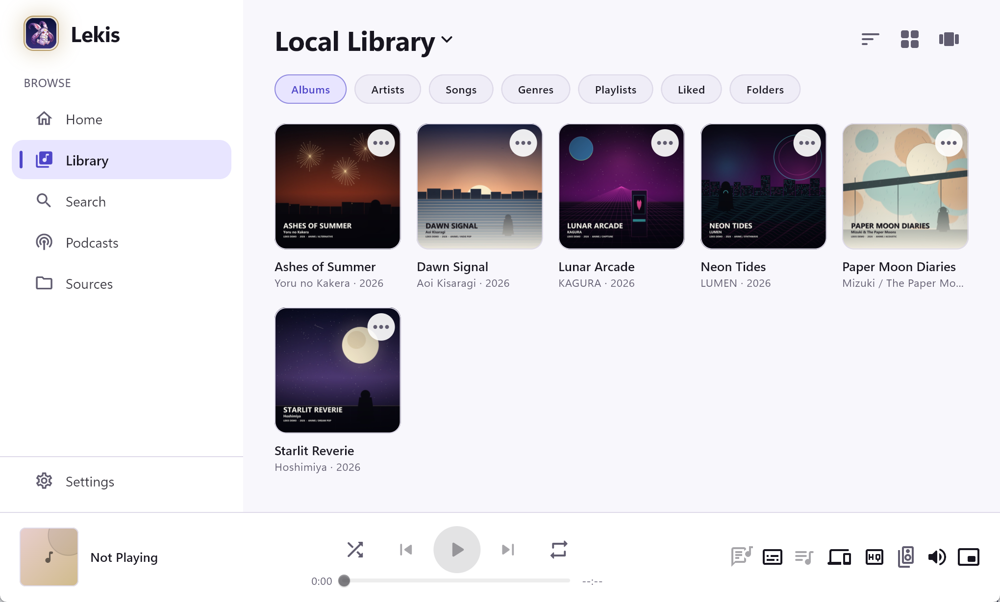
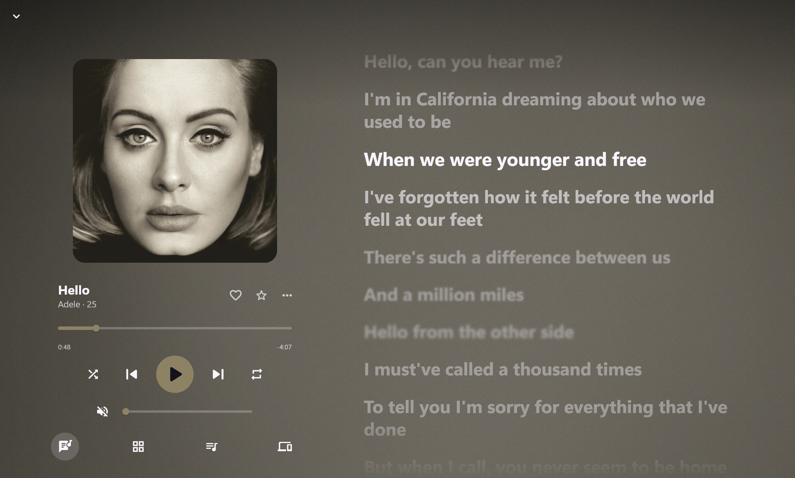
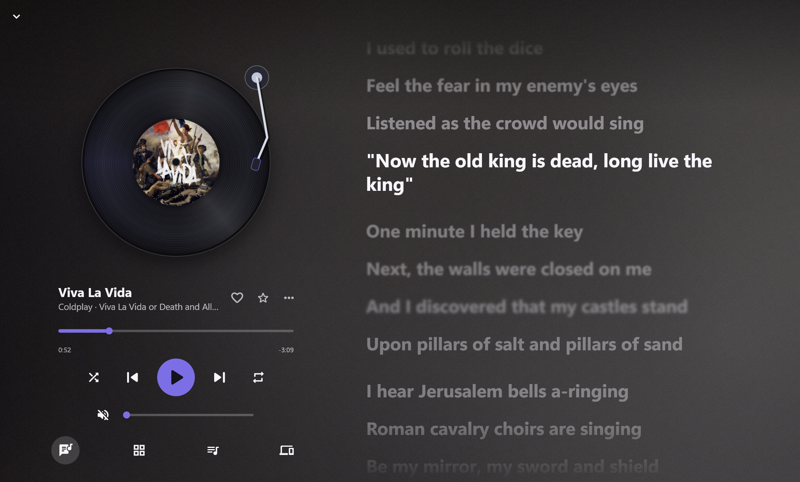
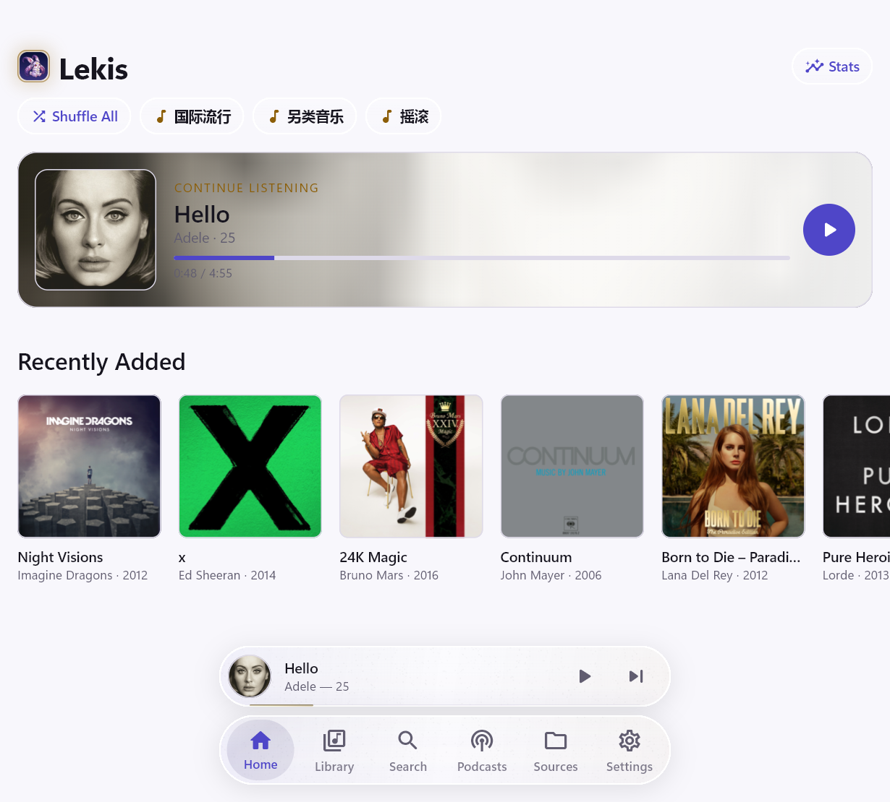
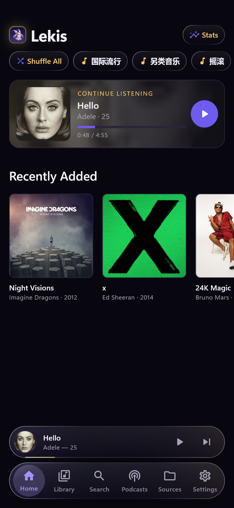
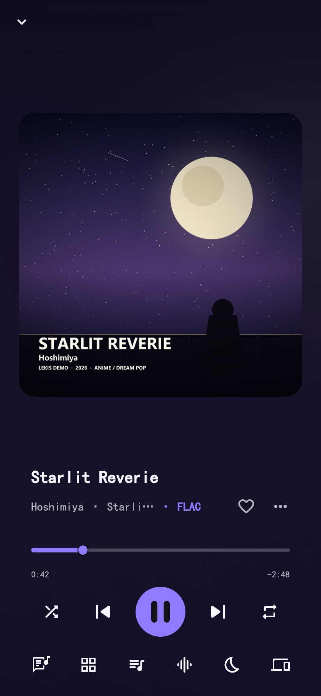
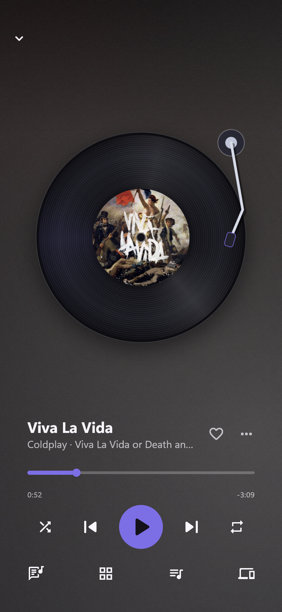

<div align="center">


# Lekis Music · 月兔音乐

**Open-Source, Cross-Platform Local & NAS Lossless Music Player — No Server Required**  
**开源跨平台本地 / NAS 无损音乐播放器 · 无需部署服务端，开箱即用**

[](https://lekis.aoxzh.org)
[](LICENSE)
[](core/)
[](app/)
[](#platforms)

**[🌐 Official Website (lekis.aoxzh.org)](https://lekis.aoxzh.org) · [English](#english) · [简体中文](#简体中文) · [Quick Facts](#quick-facts) · [FAQ](#faq) · [Plugin SDK](plugin-sdk/)**

</div>

---

> **TL;DR / 一句话介绍**  
> **Lekis Music (月兔音乐)** is a privacy-first, open-source (MPL-2.0) music player powered by a **Rust audio & library core** and a **Flutter UI**. Play music directly from local folders or your NAS (**SMB / WebDAV / NFS / SFTP**) with **zero server setup**, or connect **Navidrome / OpenSubsonic / Jellyfin / Emby / Plex**. Features **0.3s cold start on 100,000+ tracks**, **sample-accurate gapless playback**, **Windows WASAPI bit-perfect exclusive mode**, **zero-API-key artwork & synced lyrics enrichment** (with CJK/ACG support), **Windows native floating desktop lyrics**, **LAN device remote control & streaming (Connect)**, and **serverless multi-device sync**.
>
> **月兔音乐（Lekis Music）** 是一款开源（MPL-2.0）、隐私优先的本地与 NAS 无损音乐播放器（Rust 核心 + Flutter 界面）。**无需在 NAS 上部署任何服务端**，直接局域网自动发现并播放本机和 **SMB / WebDAV / NFS / SFTP** 曲库，也支持接入 **Navidrome / OpenSubsonic / Jellyfin / Emby / Plex**。具备 **10 万首曲库 0.3 秒冷启动**、**样本级无缝播放**、**Windows WASAPI 独占比特完美输出**、**免 API Key 多源封面与双语歌词自动补全**（含日区 / ACG 增强）、**Windows 原生桌面悬浮歌词**、**局域网跨设备遥控与接力串流（Connect）**、**统一资料库低音质去重**以及**无服务器多设备同步**。

---

## Screenshots · 界面预览

### Desktop · 桌面端（Dark & Dual-Column Lyrics / Vinyl）

| Home & Album Wall · 首页与专辑墙 | Dual-Column Now Playing · 宽屏双栏歌词 |
|---|---|
|  |  |

| Vinyl Turntable + Lyrics · 黑胶唱盘与歌词 | Foldable / Tablet (Light) · 折叠屏 / 平板浅色液态玻璃 |
|---|---|
|  |  |

### Mobile · 移动端（Liquid Glass & Atmospheric Now Playing）

<p align="center">
  
  &nbsp;&nbsp;
  
  &nbsp;&nbsp;
  
</p>

---

## Why Lekis Music? · 核心亮点

| Highlight / 特性 | English | 简体中文 |
|---|---|---|
| **Zero-Server NAS Direct Play** | Stream directly from **SMB, WebDAV, NFS, SFTP** & local folders with LAN auto-discovery (mDNS / WS-Discovery / SSDP) and automatic Home/Away failover — no Docker or server setup required. | **免部署直连 NAS**：直接播放本机与 **SMB / WebDAV / NFS / SFTP**，支持局域网自动发现与内外网地址自动故障切换，同时兼容 Navidrome / Jellyfin / Emby / Plex。 |
| **Audiophile Rust Core** | **100,000+ tracks** cold start in ~0.3s at 120 fps; sample-accurate **gapless playback**, **Windows WASAPI bit-perfect exclusive mode**, ReplayGain, 10-band EQ & headphone presets. | **专业级 Rust 引擎**：10 万首大曲库 ~0.3 秒冷启动、120 fps 流畅滚动；样本级无缝播放、Windows WASAPI 独占逐位一致输出、ReplayGain、10 段均衡器与耳机预设。 |
| **Zero-Key Cover & Lyrics** | Built-in 5 artwork sources + 4 lyrics sources (LRCLIB, Cover Art Archive, iTunes JP/Global, Deezer, VocaDB, etc.) with word-by-word karaoke, CJK per-locale font fallback, and **Windows native floating desktop lyrics**. | **免 Key 封面与歌词补全**：内置 5 个封面源 + 4 个歌词源（含日区 iTunes、VocaDB 与翻译歌词），支持逐字卡拉 OK、中日韩分语种字体回退与 **Windows 原生桌面悬浮歌词**。 |
| **Unified Library & Dedup** | Automatically merges duplicate tracks across local storage, NAS, and media servers, picking the highest quality; one-click cleanup of lower-quality duplicates (index or disk/NAS). | **统一资料库与低音质去重**：同一首歌在本地 / NAS / 媒体服务器的多副本自动合并择优；重复歌曲支持一键删除低音质版本并释放磁盘 / NAS 空间。 |
| **LAN Connect & Sync** | Discover and pair devices on your LAN to remote-control playback, transfer queues, and stream missing tracks; serverless multi-device sync for favorites, playlists, and history via any shared folder. | **局域网遥控与无服务器同步**：设备间局域网配对遥控、播放队列接力与缺失曲目串流；通过本地或 NAS 共享目录实现无服务器多设备同步。 |
| **Refined UI & Privacy** | Liquid Glass & flat styles, Vinyl / Cassette / Cover now-playing modes, full English & Chinese UI, JS plugin host, **no accounts, no telemetry, no ads, no Google Play Services**. | **精致界面与隐私优先**：液态玻璃 / 扁平风格、黑胶 / 磁带播放页、中英双语、本地 JS 插件宿主；**无账号、无遥测、无广告、无 Google 服务依赖**。 |

---

## Quick Facts

| Attribute | Details |
|---|---|
| **App Name** | Lekis Music (中文名：月兔音乐) |
| **Package ID (Android)** | `dev.lekis.music` |
| **License** | [MPL-2.0](LICENSE) (Open Source, FOSS) |
| **Architecture** | Rust core (`core/`) + `flutter_rust_bridge` v2 + Flutter UI (`app/`) |
| **Current Platforms** | Android 8.0+ (arm64-v8a), Windows 10/11 (x64) — macOS / iOS / Linux planned for Beta |
| **Local & NAS Protocols** | Local folders, SMB, WebDAV, NFSv3, SFTP (password & OpenSSH key) |
| **Media Servers** | OpenSubsonic (Navidrome, Gonic, Airsonic), Jellyfin, Emby, Plex |
| **Audio Formats** | FLAC, ALAC, WAV, AIFF, Opus, Ogg Vorbis, MP3, AAC / M4A |
| **Audio Features** | Sample-accurate gapless, Windows WASAPI exclusive (bit-perfect), ReplayGain, 10-band EQ + headphone presets, sleep timer (incl. end-of-track), Last.fm / ListenBrainz / Libre.fm scrobbling |
| **Telemetry / Tracking** | None (100% local data; network used only for your configured sources, metadata enrichment, podcasts/radio, and optional scrobbling) |

---

<a id="english"></a>

## English

### Overview

**Lekis Music** is built for listeners who own their music library — whether stored locally on a phone/PC, on a home NAS, or on a self-hosted media server — and want a fast, audiophile-grade player without cloud lock-in or mandatory server maintenance.

### Features

- **Flexible Music Sources**
  - Direct playback from **Local folders**, **SMB**, **WebDAV**, **NFSv3**, and **SFTP** with LAN NAS auto-discovery (mDNS / WS-Discovery / SSDP).
  - Native client support for **OpenSubsonic (Navidrome, etc.)**, **Jellyfin**, **Emby**, and **Plex**.
  - **Home / Away network failover**: automatically prefers LAN addresses at home and switches to public/VPN addresses with optional transcoding on mobile data.
  - **Unified Library**: deduplicates the same track across local files, NAS shares, and media servers, with manual merge/split and one-click removal of lower-quality duplicates.
  - **Offline downloads** for tracks, albums, and playlists; credentials stored securely in OS keystores (Android Keystore / Windows Credential Manager).
- **High-Performance Library & Management**
  - Scales to **100,000+ tracks** (~0.3s cold start, 120 fps scrolling) backed by SQLite FTS.
  - Browse by Albums, Artists, Tracks, Genres, Folders, and Favorites; Pinyin & Traditional/Simplified Chinese search; A–Z / `#` fast index scrubber.
  - Playlists, Smart Playlists (with live rule preview), 1–5 star ratings, M3U / XSPF import & export, play history, Year in Review, library health checks, and in-place audio tag editing.
- **Audiophile Playback Engine (Rust)**
  - Sample-accurate **gapless playback** (pre-decodes next track, strips MP3/AAC encoder delay & padding) and smooth 20 ms fade-in/out.
  - **Windows WASAPI Exclusive Mode** (bit-perfect output) with automatic shared-mode fallback.
  - **ReplayGain**, **10-band equalizer** with AutoEq-style headphone presets, sleep timer (15/30/60/90 min + end-of-track), playback session restore, and **Last.fm / ListenBrainz / Libre.fm** scrobbling.
  - Podcasts (directory search, charts, RSS, OPML) and Internet Radio (Radio Browser + custom streams).
- **Lyrics, Artwork & Visual Experience**
  - Zero-API-key cascading enrichment for **album artwork** (Cover Art Archive, iTunes Global/JP, Deezer, VocaDB, MusicBrainz) and **synced lyrics** (LRCLIB, etc.), with a review queue for low-confidence matches.
  - Classic lyrics view + Flow / Steps / Tilt stages, word-by-word karaoke, CJK per-locale font fallback, manual lyric & offset editor, and **Windows native floating desktop lyrics** (Win32 layered window + Direct2D/DirectWrite, click-through lock).
  - **Vinyl**, **Cassette**, and **Cover** Now Playing styles; **Liquid Glass** & **Flat** display styles; full **English / Simplified Chinese** live language switching.
- **Multi-Device & Extensibility**
  - **Lekis Connect**: discover and pair devices on your LAN to remote-control playback, transfer queues, and stream local tracks between PC and mobile.
  - **Serverless Multi-Device Sync**: operation-log + HLC sync for favorites, playlists, and play history over any local or NAS shared folder.
  - **Plugin Host**: install and manage local JavaScript plugins with explicit permissions (see [`plugin-sdk/`](plugin-sdk/)).

### Platforms

| Platform | Status | Notes |
|---|---|---|
| **Android** (8.0+, arm64-v8a) | **Alpha Preview** | Signed APK via GitHub Releases |
| **Windows** (10/11 x64) | **Alpha Preview** | Installer EXE or portable ZIP via GitHub Releases; WASAPI exclusive, system tray, SMTC, floating desktop lyrics |
| **macOS** (Apple Silicon, arm64) | **Experimental Preview** | DMG (drag to Applications) or ZIP via GitHub Releases; Intel builds discontinued |
| **Linux** (x64) | **Experimental Preview** | AppImage or `.tar.gz` bundle via GitHub Releases |

See [CHANGELOG.md](CHANGELOG.md) for detailed release history.

---

<a id="简体中文"></a>

## 简体中文

### 项目简介

**月兔音乐（Lekis Music）** 专为拥有自己本地或 NAS 音乐库的听众打造：无需折腾 Docker 或部署服务端，开箱即可直接扫描并无损播放本机与 NAS 上的音乐，同时完美兼容 Navidrome、Jellyfin、Emby、Plex 等自有媒体服务器。核心采用 Rust 编写，界面采用 Flutter 跨平台构建，追求极致性能、高保真音质与零打扰的隐私体验。

### 核心功能

- **全能音源与统一资料库**
  - **免服务端直连**：支持本地文件夹、**SMB**、**WebDAV**、**NFSv3**、**SFTP**（密码 / OpenSSH 私钥），内置局域网 NAS 自动发现（mDNS / WS-Discovery / SSDP）。
  - **媒体服务器接入**：支持 **OpenSubsonic（Navidrome 等）**、**Jellyfin**、**Emby**、**Plex**。
  - **内外网自动选路（Home / Away）**：在家优先走局域网高速直连，外出切移动网络自动切换备用/公网地址并支持媒体服务器转码。
  - **统一资料库与低音质去重**：同一首歌在本地、NAS 与多个服务器上的副本自动合并择优；支持查看/手动拆分来源，并在「资料库检查 → 重复歌曲」中一键删除低音质版本（支持仅移出索引或同步删除磁盘/NAS 源文件）。
  - **离线缓存与安全凭据**：支持单曲、专辑、歌单离线下载；密码存系统钥匙串，数据库不存明文。
- **十万级大曲库与高效管理**
  - 针对 **10 万首级别** 曲库优化：冷启动约 **0.3 秒**，列表滚动 **120 fps**。
  - 专辑 / 艺人 / 歌曲 / 流派 / 文件夹 / 喜欢浏览；支持拼音与简繁搜索、右侧 `A–Z / #` 字母与拼音快速索引条。
  - 歌单、智能歌单（支持实时预览匹配曲目）、1–5 星评分、M3U / XSPF 导入导出、播放历史、年度回顾、库健康检查与音频标签编辑写回。
- **发烧级 Rust 播放引擎**
  - **样本级无缝播放（Gapless）**：预解码下一首并精确去除 MP3/AAC 编码器延迟与填充；20 ms 淡入淡出。
  - **Windows WASAPI 独占模式**：软件链路已通过逐位一致验证，独占不可用时自动平滑回退共享模式。
  - **ReplayGain 响度均衡**、**10 段均衡器**与 AutoEq 风格耳机预设、睡眠定时（含「放完这首」）、播放会话恢复、**Last.fm / ListenBrainz / Libre.fm** 听歌上报。
  - 内置 **播客**（目录搜索、榜单、RSS、OPML）与 **网络电台**（Radio Browser 与自定义流）。
- **封面、歌词与桌面体验**
  - **免 API Key 多源补全**：级联 5 个封面源（含 Cover Art Archive、iTunes 日区/全球、Deezer、VocaDB、网易云等，针对日系 / ACG 专辑专项增强）与 4 个歌词源（含 LRCLIB、网易云翻译歌词、酷狗等），支持按需选择补全并内置待确认队列。
  - **沉浸式歌词**：经典歌词 + Flow / Steps / Tilt 歌词舞台、逐字卡拉 OK、中日韩分语种字体回退（解决中日双语汉字异体字混排）、手动编辑歌词与时间偏移。
  - **Windows 原生桌面悬浮歌词**：Win32 分层窗口 + Direct2D / DirectWrite 逐字渲染，支持拖动、鼠标穿透锁定、自定义字体与配色。
  - **多元视觉**：提供封面、**黑胶唱片**、**复古磁带**三种播放页样式，支持**液态玻璃 / 扁平**显示样式、可定制导航栏位置与中英双语实时切换。
- **跨设备体验与插件生态**
  - **局域网遥控与接力（Connect）**：局域网设备互相发现并配对后，支持遥控播放/音量/进度/队列，并将当前队列一键转移至另一台设备（对方缺失的曲目自动从本机串流）。
  - **无服务器多设备同步**：通过本地或 NAS 共享目录同步喜欢、歌单与播放历史（操作日志 + HLC，无需云服务器）。
  - **本地 JS 插件宿主**：支持社区插件安装、启用、权限管理与配置（协议见 [`plugin-sdk/`](plugin-sdk/)）。

---

## Architecture & Tech Stack · 技术架构

| Layer / 层级 | Technology / 技术 | Directory / 目录 |
|---|---|---|
| Core (All Business Logic) | Rust 2021, tokio, SQLite, symphonia, cpal / WASAPI | [`core/`](core/) |
| Flutter FFI Bridge | `flutter_rust_bridge` v2 | [`core/crates/lekis-bridge`](core/crates/lekis-bridge) |
| Cross-Platform UI | Flutter + Riverpod | [`app/`](app/) |
| Optional Headless NAS Node | Rust + axum | [`core/bins/lekis-node`](core/bins/lekis-node) |
| Plugin SDK | JSON Schema + TypeScript + WIT | [`plugin-sdk/`](plugin-sdk/) |
| Design Tokens | Platform-agnostic JSON | [`design/`](design/) |

<details>
<summary><strong>Repository Structure · 目录结构</strong></summary>

```text
.
├── core/                  Rust workspace (all business logic & audio engine)
│   ├── crates/
│   │   ├── lekis-types        Domain models, IDs, errors, events (zero IO)
│   │   ├── lekis-vfs          Virtual FS: Local / SMB / WebDAV / NFS / SFTP
│   │   ├── lekis-library      SQLite database, migrations, queries, FTS
│   │   ├── lekis-scanner      Tag scanning pipeline & NAS shared index
│   │   ├── lekis-providers    OpenSubsonic / Jellyfin / Plex / Emby clients
│   │   ├── lekis-enrich       Artwork / lyrics / metadata enrichment & scrobbling
│   │   ├── lekis-playback     Audio engine: decode → DSP → output
│   │   ├── lekis-sync         Serverless multi-device sync (op-log + HLC)
│   │   ├── lekis-plugin-host  Plugin manifest, permissions, JS runtime
│   │   ├── lekis-desktop-lyrics  Windows native layered floating lyrics
│   │   ├── lekis-core         Facade assembling all services
│   │   └── lekis-bridge       flutter_rust_bridge v2 bindings
│   └── bins/lekis-node        Optional headless NAS node
├── app/                   Flutter client (Rust compiled automatically via Cargokit)
├── fastlane/              Android Fastlane store metadata (en-US, zh-CN)
├── plugin-sdk/            Plugin protocol (JSON Schema / TS SDK / WIT / examples)
├── design/                Design tokens
├── tools/                 Build, packaging, privacy check & icon scripts
└── docs/                  Architecture, requirements, roadmap, ADRs
```

</details>

---

## Building from Source · 从源码构建

### Prerequisites · 开发环境

- **Rust**: stable toolchain ([`core/rust-toolchain.toml`](core/rust-toolchain.toml)); for Android add `aarch64-linux-android` target.
- **Flutter**: stable channel (Dart `^3.14.0`, `flutter doctor` passing).
- **Android**: JDK 17, Android SDK 37, NDK `28.2.13676358` (Cargokit builds the Rust core automatically).
- **Windows**: Visual Studio C++ Desktop workload (MSVC).

### Common Commands · 常用命令

```bash
# Rust core: format, lint, test
cd core && cargo fmt --all && cargo clippy --workspace --all-targets -- -D warnings && cargo test --workspace

# Flutter app: static analysis & tests
cd app && flutter pub get && flutter analyze && flutter test

# Android release APK (arm64-v8a)
cd app && flutter build apk --release --target-platform android-arm64

# Windows release build
cd app && flutter build windows --release

# Regenerate Dart FFI bindings after changing core/crates/lekis-bridge/src/api/
cd app && flutter_rust_bridge_codegen generate
```

Windows packaging: `tools/package-windows.ps1` (portable ZIP) and `tools/lekis-installer.iss` (installer EXE). `release.yml` also produces the macOS DMG and Linux AppImage.

---

<a id="faq"></a>

## FAQ · 常见问题

<details>
<summary><strong>Does Lekis Music require a self-hosted server like Navidrome, Jellyfin, or Plex? / 使用月兔音乐必须部署服务端吗？</strong></summary>

**No.** You can point Lekis Music directly at local folders or NAS shares via **SMB, WebDAV, NFS, or SFTP** with zero server-side software. If you *do* already run Navidrome (OpenSubsonic), Jellyfin, Emby, or Plex, Lekis Music connects to them natively and can even unify them with your local/NAS library.

**不需要。** 你可以直接通过 **SMB / WebDAV / NFS / SFTP** 播放 NAS 共享目录或本机文件夹，无需在 NAS 上部署任何服务。如果你已经部署了 Navidrome（OpenSubsonic）、Jellyfin、Emby 或 Plex，月兔音乐也能原生接入并与本地曲库统一管理。

</details>

<details>
<summary><strong>Does it support bit-perfect & gapless lossless playback? / 支持无损、无缝播放和比特完美输出吗？</strong></summary>

**Yes.** The Rust playback engine decodes FLAC, ALAC, WAV, AIFF, Opus, Ogg, MP3, and AAC natively with sample-accurate gapless transitions (stripping MP3/AAC encoder delay/padding). On Windows, WASAPI Exclusive Mode delivers bit-perfect output to your DAC/audio interface.

**支持。** Rust 播放引擎原生解码 FLAC / ALAC / WAV / AIFF / Opus / Ogg / MP3 / AAC，支持样本级无缝播放（自动去除 MP3/AAC 编码器延迟与填充）；Windows 端支持 WASAPI 独占比特完美输出。

</details>

<details>
<summary><strong>Is Lekis Music free and open-source? / 是免费开源软件吗？</strong></summary>

**Yes.** Lekis Music is licensed under **MPL-2.0**, contains no ads, no tracking, and no proprietary Google Play Services dependencies. The signed APK is published on GitHub Releases.

**是的。** 月兔音乐采用 **MPL-2.0** 开源协议，无广告、无遥测、无 Google 专有服务依赖。签名 APK 通过 GitHub Releases 发布。

</details>

<details>
<summary><strong>Where is my data stored? / 我的数据存在哪里？</strong></summary>

All library metadata, playlists, and settings stay **100% on your device** (Windows: `%APPDATA%\dev.lekis\lekis\`; Android: app private storage `dev.lekis.music`). Credentials are encrypted using your OS keystore. Optional multi-device sync writes only to the local/NAS folder you choose.

所有曲库索引、歌单与设置均**完全保存在本地**，凭据使用系统钥匙串加密；可选的多设备同步仅写入你指定的本地或 NAS 目录，不经过任何第三方云服务器。

</details>

<details>
<summary><strong>Why do notification media controls look plain on vivo / iQOO OriginOS? / 为什么 vivo / iQOO OriginOS 的通知栏播放控件看起来这么简陋、不支持原子岛？</strong></summary>

Lekis implements Android's standard `MediaSession` + `MediaStyle` media notification protocol, which automatically renders the modern media player card (cover backdrop, progress bar, output switcher) on stock Android, Pixel, Samsung One UI, Xiaomi HyperOS, and OPPO ColorOS.

On **vivo / iQOO OriginOS**, however, SystemUI disables AOSP's standard `MediaDataManager` media card for third-party players and restricts **Origin Player (原子随身听)** and **Origin Island (原子岛)** to a closed system allowlist / OEM-private verification (`com.vivo.musicwidgetmix`). Even open-source players that spoof allowlisted package names are blocked on newer OriginOS versions. As a result, OriginOS falls back to rendering a legacy basic notification card — this is an OriginOS system restriction rather than a missing feature in Lekis, and we do not ship package-spoofed workarounds.

月兔音乐完整实现了 Android 标准的 `MediaSession` + `MediaStyle` 媒体通知协议，在原生 Android、Pixel、三星 One UI、小米澎湃OS、OPPO ColorOS 上都会由系统自动渲染现代媒体播放卡片（封面背景、进度条、切歌与音频输出切换）。

但 **vivo / iQOO OriginOS** 的 SystemUI 停用了 AOSP 原生的 `MediaDataManager` 媒体卡片，并将**原子随身听**与**原子岛**（`com.vivo.musicwidgetmix`）限制在封闭的系统白名单与厂商校验内（新版 OriginOS 甚至连伪装白名单包名也会被拦截为空白卡片）。因此第三方开源播放器在 OriginOS 上只能被系统降级渲染成左侧通知栏里的基础样式卡片——这并非我们故意把控件做丑或未适配，而是 OriginOS 的系统限制，我们也不打算通过伪装其他商业 App 包名的方式去硬绕。

</details>

---

## Documentation · 文档导航

| Document | Description |
|---|---|
| [https://lekis.aoxzh.org](https://lekis.aoxzh.org) | Official website & downloads / 官方网站与下载 |
| [`plugin-sdk/`](plugin-sdk/) | Plugin protocol, TypeScript SDK & examples / 插件开发协议与示例 |
| [CONTRIBUTING.md](CONTRIBUTING.md) | Contribution & PR guidelines / 贡献指南 |
| [CHANGELOG.md](CHANGELOG.md) | Version changelog / 更新日志 |
| [SECURITY.md](SECURITY.md) | Security policy / 安全漏洞报告 |

## License · 许可证

Licensed under the **Mozilla Public License 2.0 ([MPL-2.0](LICENSE))**. Third-party notices are listed in [THIRD_PARTY_NOTICES.md](THIRD_PARTY_NOTICES.md).

---

## Community & Feedback · 关注与反馈

- If you find **Lekis Music** interesting, feel free to follow me on X: **[@aoxzh](https://x.com/aoxzh)** — and if you run into any bugs or have feature ideas, please open a **[GitHub Issue](https://github.com/aoxzh/lekis-music/issues)**!
- 如果你觉得 **月兔音乐** 有意思，欢迎关注我的 X：**[@aoxzh](https://x.com/aoxzh)**；如果使用中遇到问题或有功能建议，欢迎提交 **[GitHub Issue](https://github.com/aoxzh/lekis-music/issues)**！

